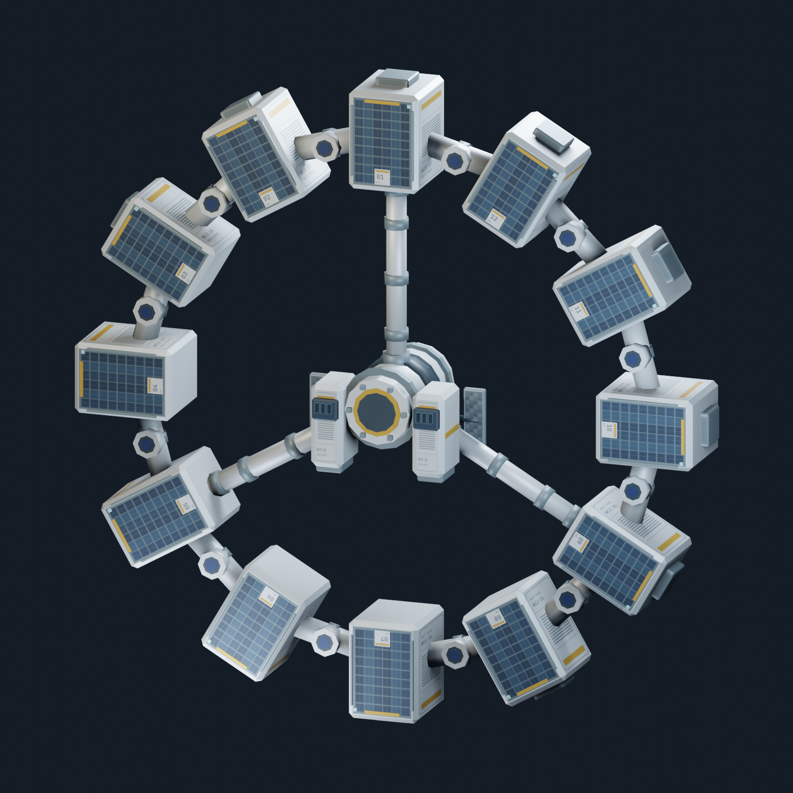

# Космічна станція — поточна версія

Оптимізована модель White Cat за кільцевим силуетом Endurance: 12 модулів, три спиці та центральний вузол. Це версія без верхнього антенного блока, маленької камери, напису на сервісних панелях і чотирьох нижніх трастерів. Два бічні службові блоки вирівняні дзеркально.

## Файли

- [космічна станція.blend](космічна%20станція.blend) — редагований Blender-файл, текстура упакована; відкривати у Blender 3.6 або новішому.
- [Space_Station.glb](Space_Station.glb) — основна модель для гри.
- [Space_Station_LOD1.glb](Space_Station_LOD1.glb), [Space_Station_LOD2.glb](Space_Station_LOD2.glb) — спрощені варіанти.
- [station_atlas.png](station_atlas.png) — спільна текстура 1024×1024; вона також вбудована в кожний GLB.
- `previews/` — загальний вигляд і крупні плани.
- `asset_info.json`, `validation.json`, `final_export_audit.json` — характеристики, перевірки та SHA-256 експортів.
- `package_manifest.json` — SHA-256 файлів цієї поставки.

| Варіант | Трикутники | Сітки | Матеріали |
|---|---:|---:|---:|
| Основний | 6 686 | 2 | 1 |
| LOD1 | 4 100 | 2 | 1 |
| LOD2 | 1 232 | 2 | 1 |

## Інтеграція

Завантажувати один LOD одночасно. GLB має +Y вгору; вісь кільця — -Z. У Blender +Z вгору; вісь кільця — +Y. Origin кільця в центрі станції. Приблизний діаметр 12,76 м; це художній масштаб.

Кільце та центральний корпус — окремі сітки, з одним непрозорим PBR-матеріалом. PNG вбудований, Draco або мережеві декодери не потрібні. LOD1/LOD2 у `.blend` розміщені в прихованих колекціях. Студійні світло й камера не експортуються в GLB. FPS у цільовій грі ще не вимірювався.

## Перевірка та походження

Усі три GLB повторно імпортовані у Blender: кількість трикутників підтверджена; вироджених трикутників і нечислових координат немає. Геометрія бічних блоків перевірена на дзеркальність.

Палітра взята з наявного `mars rover.blend`. Задня антена адаптована з NASA Mars Reconnaissance Orbiter 3D; запис джерела `nasa_mro_3d` збережений у [data/sources.json](../data/sources.json). Фото користувача використане як референс і не включене до папки. Модель художня, не інженерне креслення.

## Водний дослідницький апарат

[Поточна оптимізована версія водного апарата](aquatic_rover/README.md): редагований `.blend`, три самодостатні GLB, упаковані текстури, прев’ю й результати перевірок. LOD0 / LOD1 / LOD2: 4 460 / 3 196 / 1 660 трикутників; один матеріал, дві текстури 512×512.
