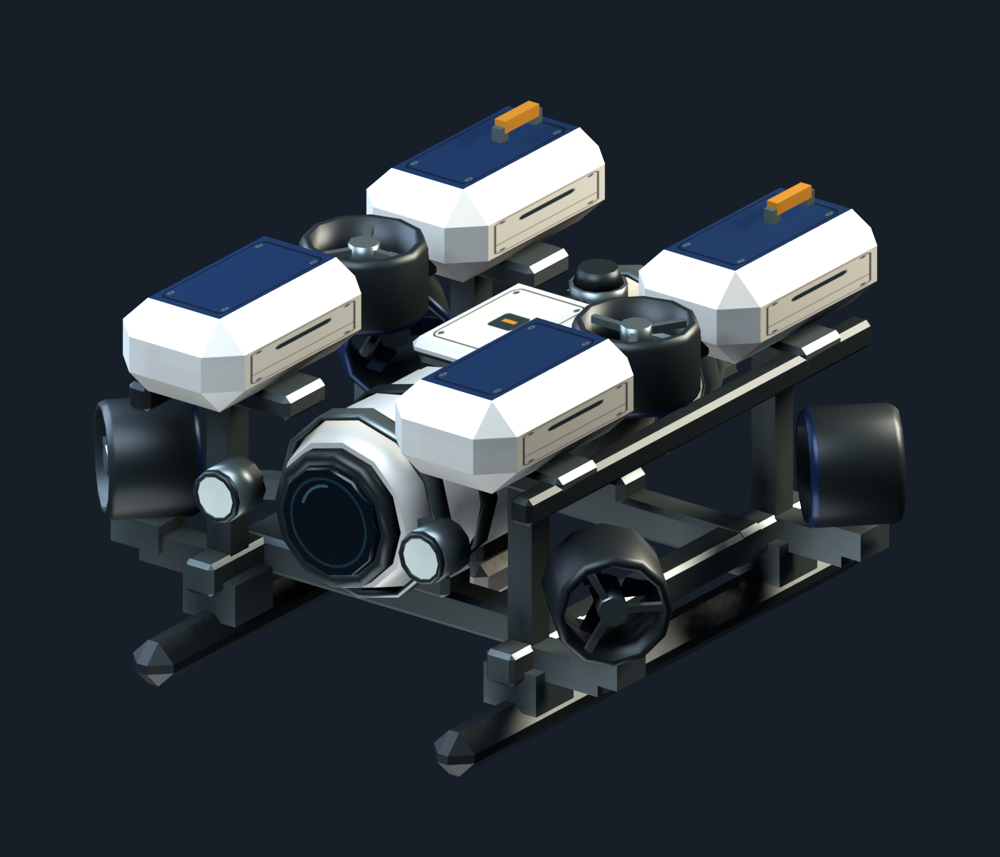

# White Cat — водний дослідницький апарат

Завершена низькополігонна модель у стилі `mars rover.blend` та наявної космічної станції. Корпус, рама, полози, чотири модулі плавучості й шість справжніх канальних рушіїв утворюють єдину конструкцію. Оригінали обох моделей не перезаписувалися; контрольні SHA-256 збережено в `asset_info.json`.

| Експорт | Трикутники | Сітки / матеріали | Розмір |
|---|---:|---:|---:|
| Aquatic_Rover.glb | 4 460 | 1 / 1 | 229 KiB |
| Aquatic_Rover_LOD1.glb | 3 196 | 1 / 1 | 159 KiB |
| Aquatic_Rover_LOD2.glb | 1 660 | 1 / 1 | 84 KiB |

Основну модель спрощено з 7 324 до 4 460 трикутників (−39%). Прибрано окремі дубльовані обідки рушіїв; синій край тепер є ділянкою матеріалу самого кожуха. Зменшено кількість сегментів невеликих циліндрів і фасок на опорах. Основний корпус LOD0 залишився 16-гранним. LOD1 зберігає дослідницькі вузли; LOD2 прибирає малопомітні датчики, хомути та руків’я й спрощує імпелери.



## Файли та інтеграція

- `Aquatic_Rover.blend` — редаговані деталі з назвами за призначенням; LOD0/1/2 в окремих колекціях. Текстури упаковані. Кожен імпелер має батьківський pivot з локальною віссю +Z для подальшої анімації. Важких модифікаторів немає.
- Три GLB — незалежні статичні ігрові моделі з одним непрозорим PBR-матеріалом і однією сіткою. Імпелери об'єднані із сіткою заради мінімальної кількості викликів малювання; готових анімацій немає. Студійні світло й камера не експортуються.
- Дві PNG 512×512: `aquatic_basecolor.png` (sRGB) і `aquatic_orm.png` (лінійні канали: R=1, G=roughness, B=metallic). Обидві вбудовані в кожний GLB; зовнішні файли для завантаження GLB не потрібні. Немає normal maps, прозорості, Draco або сторонніх декодерів.
- `previews/` — загальний вигляд, фронт, верх, задня частина, низ, крупний план кріплення, LOD та повторно імпортований GLB.
- `validation.json` — фактичні результати повторного імпорту, геометрії й перевірки пікселів упакованих текстур.

Одиниці — метри. LOD0: **2,419 × 2,320 × 1,432 м** (ширина × довжина × висота). Origin посередині між полозами на нижній опорній площині; Blender: +Z вгору, −Y вперед. glTF: +Y вгору, +Z вперед. Масштаб застосований. LOD2 має трохи інший габарит через спрощення круглих форм і відсутність руків’їв.

Завантажуйте один LOD за раз. Початкові пороги за найбільшим габаритом на екрані: LOD0 >300 px, LOD1 110–300 px, LOD2 <110 px; це початкові налаштування для перевірки в грі. GLB не перемикає LOD автоматично. Один primitive дає один базовий виклик малювання до проходів тіней/освітлення. FPS і споживання пам’яті на цільовому пристрої не вимірювалися.

Колізії, плавучість, керування рушіями та світлові компоненти фар налаштовуються в ігровому рушії. Модель є художнім ігровим апаратом; це не розрахунок реального герметичного судна й не симуляція його динаміки.

## Конструкція й перевірка

Герметичний за геометрією центральний корпус має захоплені фланцями торцеві кришки й ущільнене вікно єдиної фронтальної камери. Дві робочі фари кріпляться до переднього фланця. Під корпусом — сонар на власній опорі; ззаду — захищений проточний блок датчика води; зверху — невеликий акустичний модем. Немає випадкових написів, додаткових камер, антен або декоративних двигунів.

Чотири горизонтальні рушії розміщено під ±45° для поступального руху та розвороту; два вертикальні відповідають за глибину й крен. Верхні модулі плавучості та нижня рама візуально задають пасивну стійкість за тангажем. Вісь пропелера проходить через мотор, а статор утримує мотор у кожусі. Вертикальні водні канали відкриті між блоками плавучості. Нижні кронштейни горизонтальних рушіїв спираються на раму. Малі конструктивні перекриття приховані всередині муфт і посадочних місць.

Модель оглянуто з усіх боків, зокрема знизу, ззаду та крупним планом. Усі три GLB повторно імпортовано в чисті сцени Blender. Перевірено кількість трикутників, розміри, скінченні координати, відсутність вироджених трикутників, симетрію та відповідність розташування трикутників джерелу. Максимальна похибка дзеркальності після експорту <0,000001 м. Окремі редаговані деталі — замкнені manifold-сітки. Збірка має незалежні оболонки деталей із конструктивними перекриттями; вона не є звареним тілом для 3D-друку. Глобальне зварювання контактів у LOD1/2 створює діагностичні non-manifold ребра, які окремо відображено в звіті.

Окремо перевірено пікселі обох текстур усередині кожного GLB: вони точно відповідають вихідним PNG. Це захищає від помилки експорту каналів roughness/metallic старим вузлом Separate RGB у Blender 3.6; використано підтримуваний Separate Color. У GLB увімкнено відсікання зворотних граней.

## Стиль і референс

Основний референс: [Blue Robotics BlueROV2](https://bluerobotics.com/store/rov/bluerov2/), реальний дослідницький ROV із шістьма рушіями. [Фото конструкції](https://images.marinetechnologynews.com/images/maritime/bluerov2-photo-62260.png). Запозичено конструктивну логіку захисної рами, верхньої плавучості, центрального корпусу та розташування рушіїв; геометрію створено заново. Фото та сторонні 3D-моделі в ігровий експорт не вбудовані. Ця художня автономна адаптація не є точною копією BlueROV2.

Кольори, roughness і metallic зчитано безпосередньо з матеріалів марсохода: Ceramic white, Graphite, Gunmetal, Solar blue, Amber, Dark optics. Значення є в `source_palette.json`. В атласі ці властивості збережено для окремих ділянок одного матеріалу. Шви, кріпильні головки й забірні прорізи передано текстурою.

## Відтворення

Вихідні генератори лежать у `source/`. У корені репозиторію:

```sh
python3 qweq/aquatic_rover/source/generate_aquatic_atlas.py
```

У Python Console Blender або через Blender MCP виконати послідовно, окремими викликами:

```python
import runpy
from pathlib import Path
# Вкажіть шлях до вашого checkout.
repo = Path('/path/to/White-cat')
runpy.run_path(str(repo/'qweq/aquatic_rover/source/build_aquatic_rover.py'))
# Після успішної побудови:
runpy.run_path(str(repo/'qweq/aquatic_rover/source/finalize_aquatic_rover.py'))
# Рендери виконуються таймером у Blender:
runpy.run_path(str(repo/'qweq/aquatic_rover/source/preview_aquatic_rover.py'))
```

```sh
python3 qweq/aquatic_rover/source/verify_aquatic_exports.py
```

Потрібні Blender 3.6 з glTF add-on і Pillow для Python-скриптів. Шляхи генераторів визначаються відносно checkout. Повторна генерація перезаписує лише файли водного апарата. Після неї слід повторити візуальну перевірку та оновити SHA-256 маніфест.
