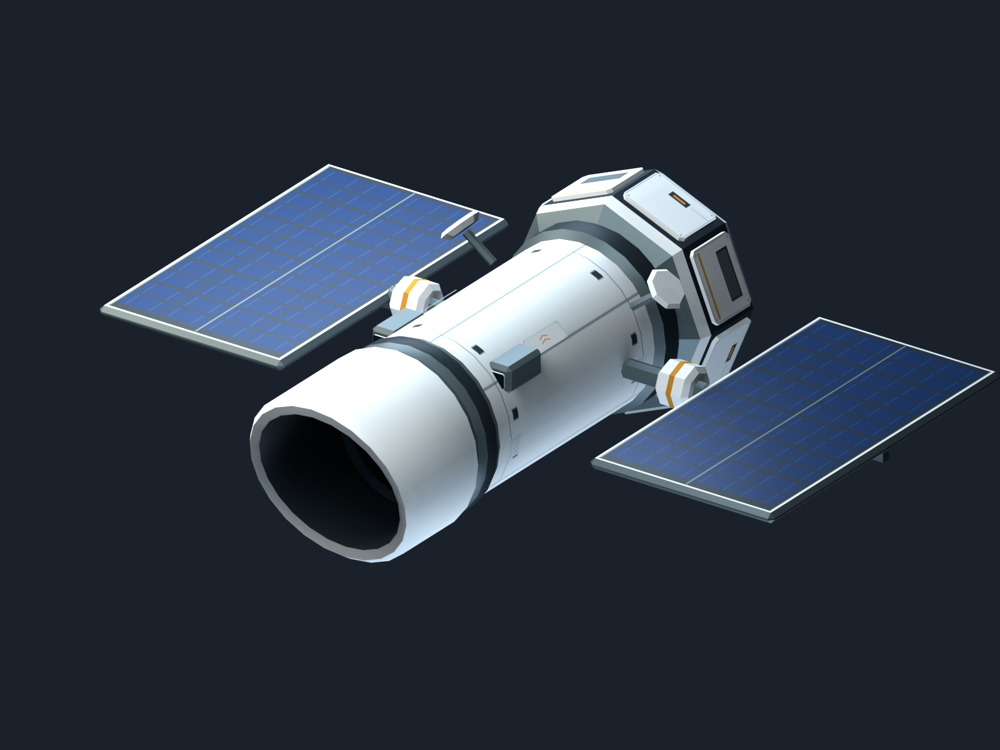

# White Cat — Hubble Telescope

Завершена авторська ігрова адаптація Hubble: вільнолітаючий телескоп для спостереження за космосом. Геометрію перебудовано в Blender, а не лише перефарбовано NASA-модель. Збережено циліндричний тубус, відкриту бленду, ширший задній службовий відсік і два бічні сонячні крила. Кріплення до станції немає. Ігровий код пошуку планет та перемикання камер не змінювався.



## Файли та фактичні бюджети

| Файл | Трикутники | Сітки / матеріали | Розмір GLB |
|---|---:|---:|---:|
| Hubble_Telescope.glb | **1 564** | 3 / 1 | 103 368 B |
| Hubble_Telescope_LOD1.glb | **702** | 3 / 1 | 57 032 B |
| Hubble_Telescope_LOD2.glb | **304** | 3 / 1 | 34 552 B |

Числа отримано після застосування модифікаторів, тріангуляції, експорту та повторного імпорту кожного GLB у чисту сцену Blender 3.6.23. Окремо перевірено кількість індексів у GLB. LOD0 має на **79,6%** менше трикутників, ніж NASA-референс із 7 672 трикутниками.

`Hubble_Telescope.blend` містить усі три LOD, упаковані текстури, студійні камери й окремі сцени перевірки. GLB самодостатні: немає зовнішніх текстур, Draco чи потрібних розширень. Завантажувати один LOD за раз; автоматичне перемикання не вбудовано. Орієнтовні початкові пороги за найбільшим габаритом на екрані: LOD0 >300 px, LOD1 100–300 px, LOD2 <100 px; уточнити в рушії. FPS на цільовому обладнанні не вимірювався.

## Огляд референсів і художні рішення

До моделювання в Blender відкрито `NASA_Telescopes_Comparison.blend`, ізольовано Hubble, оглянуто його з кількох напрямків. Фактичний бюджет — 7 672 трикутники. Вихідний апарат має довгий циліндричний корпус, ширший службовий відсік, дві довгі панелі, дрібні антени та закриту передню кришку. Розміри NASA-файла не використано як ігровий масштаб.

Потім окремо оглянуто `космічна станція.blend`, `mars rover.blend` та `assets/models/mars_helicopter/Mars_Helicopter.blend`. Спільна мова White Cat: прості широкі фаски, світлі кожухи на темних конструкціях, виразні стики, графітові заглиблення, стримані бурштинові вставки й сині комірки. Для Hubble створено відкриту скошену бленду з товстим краєм, довгий керамічний корпус, великі восьмигранні сервісні касети, широкі шарніри крил та спрощені навігаційні блоки.

Точні лінійні значення кольору, metallic і roughness зчитано з шейдерів марсохода й збережено в `source_palette.json`. В атласі кольори перетворено в sRGB із звичайним квантуванням до 8 біт:

| Роль | Матеріал джерела | sRGB |
|---|---|---|
| Кераміка | Ceramic white | #D6DBD9 |
| Заглиблення | Graphite | #323C41 |
| Конструкція | Gunmetal | #78878B |
| Акценти | Amber | #C99039 |
| Сонячні елементи | Solar blue | #233C63 |
| Оптична глибина | Dark optics | #111D27 |

За уточненням користувача прибрано чотири жовті виступи на краях сонячних крил і два жовті фіксатори біля бленди. Невеликі смуги на приводах та текстурні акценти збережено.

## Масштаб, осі та root

Одиниці — **метри**, unit scale = 1. Розміри LOD0: **6,600 м розмах × 5,075 м довжина × 1,973 м висота**. Основний тубус має діаметр близько 1,48 м; край бленди — до 1,60 м. Це **художній масштаб**, підібраний до станції діаметром 12,76 м, а не фізична специфікація Hubble. LOD1/2 мають висоту 1,94 м; через 18-гранний край бленди довжина LOD1 становить 5,072 м.

Корінь кожного GLB — **Hubble_Telescope**. Його origin `(0,0,0)` розташовано в центрі основного циліндричного тубуса, а не в центрі загального bounding box. У root немає початкового переміщення чи повороту; масштаби root і сіток `(1,1,1)`. Усю збірку переміщувати й повертати через root.

| Напрям | Blender | glTF / GLB |
|---|---|---|
| Спостереження, через відкритий отвір | **−Y** | **+Z** |
| Верх | +Z | +Y |
| Розмах крил | X | X |
| Задній службовий відсік | +Y | −Z |

glTF-експортер застосовує перетворення `(x,y,z) Blender → (x,z,−y) glTF`.

Ієрархія однакова в усіх GLB:

```text
Hubble_Telescope
├── Telescope_Body
├── Solar_Panel_L
├── Solar_Panel_R
└── Telescope_View
    └── Telescope_View_Check [perspective camera]
```

У `.blend` альтернативні LOD мають суфікси, щоб їхні назви не конфліктували. Під час експорту імена нормалізовано.

## Ігрова камера

**Telescope_View** — окремий нерендерний вузол на оптичній осі. Його позиція відносно root:

- Blender: `(0, −2.78, 0)` м;
- GLB: `(0, 0, +2.78)` м.

Камера стоїть на 0,11 м попереду найбільш виступаючого краю бленди. Mount має **нейтральний поворот**. Напрям спостереження задається осями вище; нейтральний mount сам по собі не є камерою, що дивиться вздовж локальної −Z.

Дочірня **Telescope_View_Check** уже зорієнтована правильно: вперед −Y / вгору +Z у Blender та вперед +Z / вгору +Y у GLB. У glTF її локальний quaternion XYZW — приблизно `(0,1,0,0)`, тобто 180° навколо Y: стандартна glTF-камера дивиться вздовж −Z, тому цей поворот потрібен для огляду вздовж +Z. Для ігрової камери можна використати світовий transform цього дочірнього вузла або зорієнтувати нову камеру від mount у напрямку +Z із верхом +Y.

У Blender перевірочна камера має об'єктив 50 мм, near clip 0,01 м, far clip 10 000 м. Параметри FOV, near/far та пропорції екрана налаштувати під гру. Камера не моделює реальну оптичну систему Hubble.

У кожному повторно імпортованому GLB перевірено **627 променів** через кадр: **0 перетинів із геометрією телескопа**. `previews/Telescope_View.png` — рендер через цю камеру на тестову мішень за 20 м попереду. Мішень існує лише в QA-сцені й не входить до GLB.

## Сонячні крила

Дві сітки крил відокремлено для сонячного стеження. Центри шарнірів:

| Крило | Blender | glTF |
|---|---|---|
| Solar_Panel_L | (−1.50, 0.64, 0) | (−1.50, 0, −0.64) |
| Solar_Panel_R | (+1.50, 0.64, 0) | (+1.50, 0, −0.64) |

Вісь обертання кожного крила — його локальна **X** в обох форматах. Початкова поза розгорнута, комірки спрямовано до +Z у Blender / +Y у GLB. Анімацій немає. Положення шарнірів однакове в усіх LOD.

## Геометрія й матеріал

LOD0: 1 424 трикутники корпусу й по 70 на кожне крило. LOD1: 562 + 70 + 70. LOD2: 248 + 28 + 28. Кругові профілі перебудовано вручну з 24 / 18 / 12 сегментами; задній блок зберігає восьмигранний силует. LOD1 прибирає окремі сервісні касети, малі сенсори й антени; LOD2 додатково спрощує пояси, приводи та краї крил. Глобальний Decimate не застосовано.

Прибрано закриті всередині стиків торці, приховане продовження тубуса у службовому відсіку, зайві поверхні рам під сонячними елементами та непотрібні внутрішні оболонки. Внутрішні стінки бленди, заглиблений кільцевий перехід і темний оптичний стоп тепер утворюють одну з’єднану чашу зі спільними вершинами. Зазору між стінкою та дном немає; складних дзеркал усередині немає. Деталі утворюють механічну збірку; приховані межі в місцях з'єднання навмисно відкриті. Subdivision та незастосованих модифікаторів у фінальних сітках немає.

Один непрозорий PBR-матеріал із backface culling і спільною UV-розкладкою. Два атласні PNG **1024×1024** упаковано у `.blend` і кожний GLB:

- `hubble_basecolor.png` — sRGB, палітра, комірки, стики, решітки, кріплення;
- `hubble_orm.png` — Non-Color, R=1, G=roughness, B=metallic. Окремого AO-входу немає; перевірено саме канали G/B у GLB.

Три сітки, три primitives, один матеріал: три базові виклики малювання перед тіньовими та іншими проходами рушія. Немає прозорості, текстурних normal maps або процедурних runtime-шейдерів. Вихідні PNG залишено для редагування, але для використання GLB вони не потрібні.

## Сцени Blender і прев'ю

Файл відкривається у **Style Review | station + Hubble**: оновлена станція та телескоп поруч, у своїх художніх масштабах. Телескоп показаний як вільнолітаючий апарат. Це сцена оцінки стилю; станція і студійне освітлення не експортуються з телескопом.

- **White Cat | Hubble Telescope** — власне модель, root у нулі, видимий LOD0; LOD1/2 в прихованих колекціях `HUBBLE / LOD1`, `HUBBLE / LOD2`.
- **Camera Clearance | test target** — перевірка ракурсу через Telescope_View_Check із правильно орієнтованою мішенню.

`previews/` містить `hero`, `front`, `side`, `rear`, `underside`, `aperture`, `LOD1`, `LOD2`, `GLB_roundtrip`, `station_comparison`, `Telescope_View`. `overview.jpg` та `LOD_comparison.jpg` — контактні аркуші.

## Перевірки та збереження джерел

`validation.json`: повторний імпорт кожного GLB у Blender; фактичні трикутники, матеріал, масштаб, bounds, позиція mount, напрям і верх камери, 627 променів без перекриття. Нуль вироджених трикутників, нуль зайвих вершин, усі координати скінченні.

`glb_validation.json`: незалежне читання GLB; три primitives, один непрозорий матеріал, вбудовані PNG, точний збіг пікселів base color та каналів roughness/metallic, імена вузлів, pivots крил, орієнтація камери й SHA-256 експортів.

NASA GLB, проєкт порівняння, марсохід та гелікоптер залишилися без змін; початкові SHA-256 — у `source_integrity.json`. **Станцію змінено за подальшим прямим уточненням користувача:** прибрано дві додаткові панелі на центральному вузлі та їхні шарніри (−128 трикутників LOD0). Оновлено `космічна станція.blend`, `assets/models/Space_Station*.glb` та прев'ю станції. Попередній файл станції й GLB збережено в `assets/revisions/hubble_cleanup_2026-11-15/`. `station_revision.json` документує цю зміну й хеш оновленого файла. Бюджет станції після правки: **6 558 / 4 100 / 1 232** трикутники.

## Походження й кредит

Референс: **NASA 3D Resources — Hubble Space Telescope (A)**. Кредит оригінальної моделі: **DigitalSpace Corporation**. [Сторінка джерела NASA](https://science.nasa.gov/3d-resources/hubble-space-telescope-a/).

Локальний оригінал: `data/models/telescopes/Hubble Space Telescope (A).glb`; SHA-256 `e5ba4de15c7d359ac8fa1ab7e286aff42dec09c0fadae3db99252587f39fa384`. Повний запис походження й адреса завантаження збережені у `data/models/telescopes/sources.json`. Кредит також записано у властивостях root і сцени. Геометрія адаптації та атлас створені заново для White Cat; модель не є інженерним кресленням або офіційною моделлю NASA.

Станція в сцені порівняння зберігає власні кредити, включно з адаптованою антеною NASA MRO; див. `assets/models/space_station/README.md`.

## Відтворення

Скрипти лежать у `authoring/`. Вони розраховані на поточний шлях проєкту, заданий у `ROOT`.

1. Звичайним Python із Pillow виконати `generate_atlas.py` та `generate_camera_target.py`.
2. У Blender послідовно виконати `build_hubble.py`, `export_validate.py`, `preview_hubble.py`. Дочекатися `previews/render_status.json` із `done: true`.
3. Звичайним Python виконати `verify_glb.py` і `make_contact_sheets.py`.

Скрипт `remove_station_panels.py` — вже виконана одноразова правка попередньої станції; не запускати повторно на очищеному файлі. Генератор станції також оновлено, щоб ці панелі не поверталися під час подальшої перебудови.

## Виправлення внутрішнього зазору

Після зауваження користувача прибрано щілину 0,07 м між внутрішньою стінкою бленди та окремим диском. Окремий диск замінено суцільною чашею: стінка переходить у заглиблене дно через темне металеве кільце. Виправлено всі три LOD, бюджети трикутників збережено. Після повторного імпорту кожного GLB 8 712 похилих променів перевіряють перекриття внутрішньої порожнини до площини дна: 0 пропусків і 0 зворотних граней. До виправлення той самий тест виявляв 648 пропусків у LOD0. Початкові 627 променів оглядової камери також проходять без перекриття. Попередня версія збережена в `assets/revisions/hubble_before_bore_fix/`. Крупний план: `previews/aperture.png`.

## GitHub-поставка

Ця папка `qweq/hubble_telescope/` містить актуальні готові файли. Шляхи `assets/...`, `data/...` і кореневі `.blend` у документації позначають локальні джерела проєкту; сирий NASA GLB та резервні копії не входять до цієї поставки. Запис NASA з кредитом DigitalSpace Corporation включено окремо в `reference_source.json`. Станція для гри лежить у батьківській папці `qweq/`; у файлі телескопа її копія є лише в сцені порівняння.
